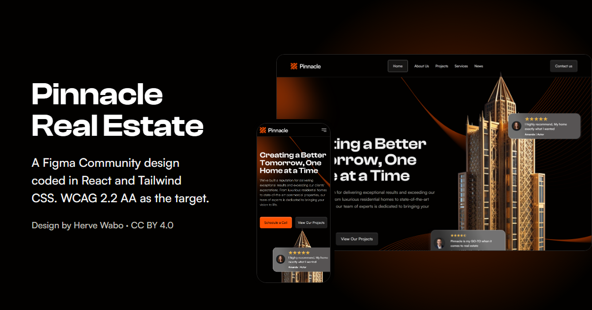

# Pinnacle Real Estate · Maquetación de un diseño de la Figma Community

Caso de estudio de maquetación y accesibilidad: un diseño ajeno de la Figma Community llevado a React y Tailwind CSS v4 con fidelidad al píxel. El sitio inmobiliario es la excusa. Lo que se demuestra es calcar el trabajo de otro diseñador, documentar cada cambio con su motivo y construir lo que el diseño no dibujó: estados, teclado, foco y lectores de pantalla.

**Demo:** [pinnacle-real-estate.netlify.app](https://pinnacle-real-estate.netlify.app)

**Diseño:** [«Free Real Estate Portfolio website template.»](https://www.figma.com/community/file/1387710768278467368/free-real-estate-portfolio-website-template) de Herve Wabo, en la Figma Community, con licencia [CC BY 4.0](https://creativecommons.org/licenses/by/4.0/). En alcance: Home, Projects, Project Details, Contact y 404, a 1440, 774 y 360.

[](public/og-image.png)

---

## Qué demuestra

- **Fidelidad verificable.** Medidas, separaciones, radios y colores salen de Figma, también fuera de la base 4. Cada cambio respecto al diseño está en una tabla con el valor original, el corregido y el motivo (54 desviaciones, 2 retiradas), así que la fidelidad se puede comprobar contra el archivo.
- **Estados que el diseño no dibujó.** Foco, hover, error, abierto y deshabilitado de todos los controles, diseñados con el sistema del propio archivo: menú móvil, validación de formularios, buscador sin resultados, confirmaciones y alto contraste (61 añadidos documentados).
- **Accesibilidad implementada.** Objetivo WCAG 2.2 AA: semántica y encabezados, foco gestionado al navegar y al validar, regiones de estado para los avisos, enlaces de salto, `forced-colors` y nombres accesibles en todos los controles.
- **Nativo antes que ARIA.** Desplegables y selector de prefijo con `<select>` nativo bajo una cara propia, y carrusel con desplazamiento nativo y `scroll-snap`, sin dependencia. React Aria Components solo en las pestañas.
- **Tres anchos y todo lo de en medio.** Móvil primero, con dos breakpoints literales del diseño (774 y 1440). Entre ellos se calca la composición de 774, barrida de 1 en 1 px en Chromium y Firefox; por encima de 1440 el contenido se centra y los fondos llegan al borde.

---

## Cambios respecto al diseño

El cambio más visible: **el texto de los botones naranjas es oscuro y no blanco.** Sobre `#FF5200`, el `#F0F0F0` del diseño da 2,85:1 y el blanco puro, 3,25:1; el texto normal necesita 4,5:1. Con `#020100` da 6,41:1, sin tocar el naranja de la marca.

| ID | Elemento | Diseño | Código | Motivo |
|---|---|---|---|---|
| D6 | Texto de los botones naranjas | `#F0F0F0`: 2,85:1 | `#020100`: 6,41:1 | Contraste de texto normal (1.4.3) |
| D48 | Fondo de las reseñas del hero | Cristal al 50 % sobre la torre: 1,47:1 | Capa opaca bajo el mismo degradado: ≥ 4,63:1 | Contraste (1.4.3) |
| D49 | Título de About sobre el naranja | `#F0F0F0`: 2,85:1 | `#FFFFFF`: 3,25:1 | Texto grande (1.4.3) |
| D50 | Párrafo de About sobre el naranja | `#FFFFFF`: 3,25:1 | `#020100`: 6,41:1 | Contraste (1.4.3) |
| D2… | Bordes de campos, pestaña activa y página actual | Hasta 1,22:1 | `#8D8D8C`: ≥ 5,49:1 | Límite de un control (1.4.11) |
| D5 | Página actual en el menú | «Home» marcado en todas las páginas | La página real, con `aria-current` | Estado incorrecto |
| D24 | Orden de los campos de Contact a 774 | Distinto del de 1440 y 360 | Uno solo en el DOM | Orden del foco (2.4.3) |

La tabla completa, con los añadidos y las diferencias entre anchos, está en [DESIGN.md](DESIGN.md).

---

## Stack tecnológico

**Estructura**

  

**Estilos**


**Accesibilidad**

 

**Build y herramientas**

  

**Diseño**


**Despliegue**


**Control de versiones**

 

---

## Accesibilidad

El objetivo es **WCAG 2.2 AA**. Este README no afirma conformidad: dice qué se probó, cómo y qué queda abierto. El detalle está en [DESIGN.md](DESIGN.md) § Accesibilidad implementada y § Pruebas.

**Por programa.** Cada cambio se midió en Chromium y en Firefox con comprobaciones automáticas de un solo uso que no forman parte del repo: medidas frente a Figma, orden de Tab y contornos de foco, alto contraste emulado, 56 casos de navegación y foco, y la huella antes y después en 7 rutas y 5 anchos.

**A mano, contra el sitio desplegado:**

- Teclado en las 6 rutas y el newsletter, con Firefox en un portátil de 1366 × 768: sin fallos.
- NVDA 2026.2 con Chrome en las 6 rutas, los avisos, los formularios y los créditos.
- TalkBack con Chrome en Android, más el tacto: menú, anclas, carrusel, formulario de Contact, panel de compartir del sistema y teclado virtual.
- Alto contraste real de Windows (tema Acuático) con Chrome, en 4 rutas y el footer.

**Corregido tras las pruebas manuales:**

- Espacios ocultos que no llegaban al árbol de accesibilidad: NVDA leía «We're buildingcommunities.».
- El aviso del buscador se callaba si se volvía a enviar sin cambiar la URL.
- La casilla de términos se anunciaba «entrada inválida» antes de enviar (con `required` nativo en Chromium); ahora lleva `aria-required`.
- El error del newsletter se leía dos veces.
- En alto contraste, los campos mostraban dos indicadores de foco.

**Diferencias propias del navegador y del lector**, anotadas sin corregir: en Firefox, un clic en un título enfocable por script y Tab vuelve al principio de la página; si se pulsa un enlace de ancla con la rueda aún girando, la página sigue a la rueda; con NVDA activo, el primer Tab va a «Skip to footer» porque el cursor de exploración ya está en el primero.

**Queda abierto:**

- Sin probar: NVDA con Firefox, TalkBack con Firefox, alto contraste real en Firefox, el gesto táctil real en el carrusel y los movimientos con «reducir movimiento» (revisados en el código, no medidos).
- Sin dispositivo: Safari de macOS e iOS y VoiceOver.

---

## Alcance y límites

- **SPA renderizada en cliente, como decisión consciente.** El HTML inicial llega vacío y las tarjetas al compartir usan solo los metadatos estáticos. Para un portafolio no afecta; un sitio con necesidades de SEO se prerenderizaría.
- **Sin backend.** El buscador filtra un JSON local con los filtros en la URL. El newsletter y el formulario de Contact validan y simulan el envío: no hay petición de red y los datos no se guardan.
- **404 de la aplicación.** Lo pinta React y el servidor responde 200.
- **Carga de imágenes medida de forma acotada**, no como medida de rendimiento: conexión lenta simulada, 4 rutas y 2 anchos. La foto principal de cada ruta aparece entera al terminar de cargar, en vez de pintarse por franjas.
- **Foto 03 de The Grand Estate:** su origen en Figma mide 724 px y entre 1302 y 1439 se muestra ampliada hasta ×1,2.
- **Fuera de alcance:** las páginas About us, Services, Blog, Blog Details y Privacy Policy del archivo. Sus enlaces llevan a una página genérica que lo explica.

---

## Inicio rápido

Requisitos: Node 26 (`.nvmrc`) y pnpm 11.

```
git clone https://github.com/Osvalam86/pinnacle-real-estate.git
cd pinnacle-real-estate
pnpm install
pnpm dev
```

Abre <http://localhost:5173>. Las fuentes se cargan desde la API de Fontshare, así que hace falta conexión.

| Script | Qué hace |
|---|---|
| `pnpm dev` | Servidor de desarrollo de Vite en `localhost:5173` |
| `pnpm build` | Comprueba los tipos y genera `dist/` |
| `pnpm lint` | ESLint con `jsx-a11y` en modo estricto |
| `pnpm preview` | Sirve `dist/` en `localhost:4173` |

---

## Estructura del proyecto

```
pinnacle-real-estate/
├── src/
│   ├── components/     # secciones y piezas compartidas (Button, Carousel, SectionTitle…) e icons.tsx
│   ├── pages/          # Home, Projects, Project Details, Contact, 404 y página genérica
│   ├── layouts/        # RootLayout: cabecera, main, footer y fondo del sitio
│   ├── routing/        # foco al navegar, anclas y título de página
│   ├── data/           # los 9 proyectos (JSON), filtros, textos y medidas de imagen
│   ├── styles/         # theme.css (tokens de Figma en @theme) y app.css
│   └── assets/         # SVG exportados de Figma y banderas
├── public/             # imágenes WebP con variantes por ancho, favicon e imagen OG
├── licenses/           # licencias de iconos y banderas de terceros
├── DESIGN.md           # contrato diseño-código: desviaciones, añadidos y pruebas
├── netlify.toml        # build y caché inmutable de /assets
└── vite.config.ts      # reparto del JS en cuatro trozos
```

---

## Documentación

- [DESIGN.md](DESIGN.md): criterio de fidelidad, tokens y valores arbitrarios, reglas de maquetación, rutas y foco, comportamiento de cada componente, accesibilidad implementada, tablas de desviaciones (D1–D54) y de añadidos (A1–A61), diferencias propias del navegador, pruebas y límites conocidos.
- [LICENSE](LICENSE) y [licenses/](licenses/): licencia del código y textos de licencia de terceros.

---

## Créditos

**Diseño.** [«Free Real Estate Portfolio website template.»](https://www.figma.com/community/file/1387710768278467368/free-real-estate-portfolio-website-template) de Herve Wabo, [CC BY 4.0](https://creativecommons.org/licenses/by/4.0/). Adaptado para este caso de estudio: los cambios están en [DESIGN.md](DESIGN.md) § Desviaciones. Las 16 fotos exportadas del archivo se usan bajo la misma licencia.

**Fuentes.** Clash Display y Satoshi de la Indian Type Foundry, servidas por [Fontshare](https://www.fontshare.com) bajo la ITF Free Font License. No se incluyen en el repo: la licencia no permite distribuirlas.

**Iconos y banderas.**

| Familia | Iconos | Licencia | Archivo |
|---|---|---|---|
| [Streamline](https://www.streamlinehq.com) (Core, Flex y Logos) | Campos, newsletter, compartir e icono de X | Streamline Free License / CC BY 4.0 | — |
| [Hugeicons](https://hugeicons.com) | `new-twitter` (X en Contact) y `arrow-down-01` (desplegables) | MIT | [licenses/hugeicons-LICENSE.md](licenses/hugeicons-LICENSE.md) |
| Hugeicons (`hugeicons-react`, 2024) | `arrow-left-02` («Back to all Projects») | CC0 1.0 | — |
| [Unicons](https://iconscout.com/unicons) | `calendar-alt` (fecha de las noticias) y `arrow-right` (flechas del carrusel) | IconScout Simple License | [licenses/unicons-LICENSE.txt](licenses/unicons-LICENSE.txt) |
| [circle-flags](https://github.com/HatScripts/circle-flags) | 7 banderas del selector de prefijo (Camerún sale del archivo de Figma) | MIT | [licenses/circle-flags-LICENSE.md](licenses/circle-flags-LICENSE.md) |

Los demás iconos del archivo, sin origen identificado, se usan bajo la licencia del diseño. Los logos de Facebook, LinkedIn, X y YouTube son marcas de sus dueños y solo enlazan a cada red.

**Contenido generado y ficticio.**

- Generados con IA: los 10 retratos (reseñas, clientes y testimonios), la foto del hero de Contact y las fotos de los proyectos 7 a 9.
- Ficticios: Pinnacle, sus datos de contacto, los testimonios y las reseñas, las direcciones y el contenido de los proyectos que el diseño no desarrolla. Los proyectos 7 a 9 (The Arcade, The Workshop y The Terraces) son inventados y se añadieron para que «See More» exista también a 1440.

---

## Autor y licencia

**Osvaldo Ocampo** · [LinkedIn](https://www.linkedin.com/in/osvaldo-ocampo) · [GitHub](https://github.com/Osvalam86)

Construido con asistencia de herramientas de IA; las decisiones, la revisión del código y las pruebas manuales son del autor.

- **Código y documentación:** MIT ([LICENSE](LICENSE)).
- **Fuera de la licencia MIT,** con la licencia de su autor: el diseño original de Herve Wabo y las fotos exportadas de su archivo (CC BY 4.0); las imágenes y los retratos generados; los iconos y las banderas (ver Créditos); las fuentes Clash Display y Satoshi (no incluidas); y las dependencias.
